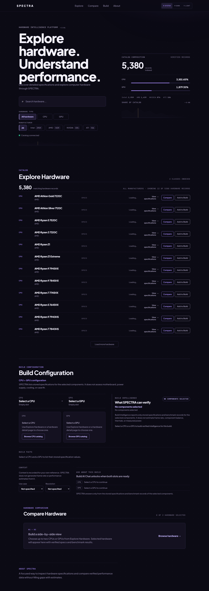
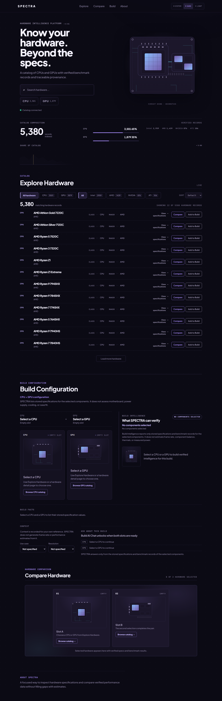

# SPECTRA V3 — Source-to-Screen Forensic Audit & Visual Recovery Report

**Date:** 2026-11-10 (UTC)
**Production URL:** <http://100.113.157.0:8080/>
**Expected release:** `75eba50b1f09052f40409f6066a2ac030344d1a0`
**Mode:** investigate → prove → fix → verify (read-only on production; no rebuild, redeploy, migration, or database change)
**Final verdict:** `VISUAL_V3_ALREADY_CORRECT`

---

## 1. Executive summary

The homepage at <http://100.113.157.0:8080/> **already renders the approved Phase F/G Neural
Luxury design**. It was not necessary to restore anything, because nothing was lost from the
deployed artifact.

The user-supplied screenshot ("Explore hardware. Understand performance." plus a
*Catalog composition* panel on the right, no CPU/GPU artwork) is the **pre-V3 frontend**:
the build that was in production *before* V3 was deployed on 2026-11-09 23:36 +07. That exact
design is reproduced byte-for-byte by the retained pre-V3 image
`spectra-frontend:rollback-75eba50` (`sha256:52369140ad11…`), built 2026-11-08 14:22 +07 —
before Phase F (`8378eb0`, 2026-11-08 22:32 +07) existed.

So the mismatch is **A. Wrong source revision** in the screenshot/observation, not a regression
in the deployed V3 code. The current production build is source-identical to `main`: rebuilding
current source with `VITE_API_BASE_URL=/api` reproduces the served JS hash exactly
(`index-DG6KnBNx.js`, `b55cce21…`).

No code change, hotfix branch, or deployment was made. A latent infrastructure hazard was found
and documented (§12) but not altered.

**No human visual approval is claimed in this report.** The agent cannot perform subjective
image inspection; visual equivalence is asserted only on the strength of objective pixel
comparison against the committed Phase G evidence (§7).

---

## 2. What production actually serves

### 2.1 Port ownership

| Item | Value |
|---|---|
| Listener on 8080 | Docker proxy, `100.113.157.0:8080` only |
| Container | `spectra-frontend` (`fb2f3aa8bb46…`) |
| Image | `sha256:6dec82c38484fc93e3d55f2a0e1fb3c4b2694b0558ae46c928124e0e5ff5e233` |
| Tag | `spectra-frontend:75eba50b1f09052f40409f6066a2ac030344d1a0` |
| Revision label | `org.opencontainers.image.revision=75eba50b1f09052f40409f6066a2ac030344d1a0` |
| Compose project | `spectra`, config `/home/david/releases/spectra-75eba50-ops/compose.json` |
| Created / started | `2026-11-09T16:35:59Z` / `2026-11-09T16:36:02Z`, `RestartCount=0` |
| Backend | `spectra-backend` (`8bb67a872fdd…`), healthy |

No second container, no system nginx (`inactive`), no other process owns the port.
`localhost:8080` on DavidLab is refused by design — the port is bound to the Tailscale IP only.

### 2.2 Served artifacts

| Path | Status | SHA256 | Size |
|---|---|---|---|
| `/` (`index.html`) | 200, `Cache-Control: no-cache` | `7b71b1396050828edadf4710184d18a040652d974a325a58188f7b0928473e01` | 2,712 B |
| `/assets/index-DG6KnBNx.js` | 200, immutable | `b55cce21e86e65335159d8b822f35185636dbf2de5b8fba8214ea3dfd3d73d81` | 355,880 B |
| `/assets/index-BNoD5QdN.css` | 200, immutable | `5ec97163b088d8c2c009c0171c028288bf42956c847753d01998e66d44186b96` | 122,723 B |
| `/assets/index-qdrmLzgf.js` (pre-V3) | **404** | — | — |

The same index hash was returned from DavidLab, from the Windows client, via `http://david-lab:8080/`,
and via a cache-busted URL (`/?cachebust=20261110`). Container files match the served bytes exactly.

Bundle content check (served JS):

| Marker | Count |
|---|---|
| `Know your hardware` | 1 |
| `Beyond the specs` | 1 |
| `hero-stage` | 1 |
| `Explore hardware` | **0** |
| `Understand performance` | **0** |
| `serviceWorker` | 0 |

### 2.3 Build provenance (source → screen)

```
frontend/src/App.jsx  (main @ 68ba010, source identical to 75eba50 for this file)
  └─ npm run build  with  VITE_API_BASE_URL=/api
       ├─ dist/assets/index-BNoD5QdN.css   sha256 5ec97163…   ← matches production
       └─ dist/assets/index-DG6KnBNx.js    sha256 b55cce21…   ← matches production
```

Without the env var the build emits `index-D6hl2_tX.js` (different hash) — the Docker build passes
`VITE_API_BASE_URL=/api` (`Dockerfile.frontend` build arg), which is why the deployed filename is
`DG6KnBNx`. This is proof the deployed bundle came from this source, not merely a coincidental
image tag match.

---

## 3. Source investigation — both headlines

### 3.1 Who renders each headline

Both headlines live in the same component: `frontend/src/App.jsx`, inside `<main className="hero">`,
inside `hero-content`.

| Headline | Source location (current `main`) | Rendered by |
|---|---|---|
| "Explore hardware. / Understand performance." | not present on `main` | pre-V3 `App.jsx` only |
| "Know your hardware. / Beyond the specs." | `frontend/src/App.jsx:3713-3717` | `App` → root route |

`HeroStage` is **defined** at `frontend/src/App.jsx:278` and **mounted unconditionally** at
`frontend/src/App.jsx:3805`:

```jsx
3803        </div>
3804
3805        <HeroStage />
3806      </main>
3807
3808      <SignalReadout
3809        profile={signalProfile}
```

There is no router (`frontend/src/main.jsx` renders `<App />` directly), no feature flag, no
condition, no lazy import, and no `React.lazy` around `HeroStage`. `HeroStage` renders
`<div className="hero-stage" aria-hidden="true" data-testid="hero-stage">` with
`className="hero-stage-svg"` (`App.jsx:284-286`), containing `hero-stage-cpu` and `hero-stage-gpu`
groups (`App.jsx:328`, `:348`) and two `hero-stage-link` paths (`:361`, `:368`).

### 3.2 Commit-by-commit history

| Commit | Date | Headline state | HeroStage |
|---|---|---|---|
| `4d37dca` (initial import) | 2026-11-02 | **"Explore hardware. / Understand performance."** at `App.jsx:3522`; hero right half is a `Catalog composition` panel | absent |
| `4206837` — Phase E2 | 2026-11-08 | **replaced** with "Know your hardware. / Beyond the specs." (`App.jsx:3636`) | absent (ambient `HeroHardwareArt`) |
| `8378eb0` — F1+F2 | 2026-11-08 | unchanged | **introduced** `function HeroStage()` (`:274`), mounted at `:3782` |
| `264e826` — F7 (Phase F report) | 2026-11-08 | unchanged (`:3725`) | `:276`, mounted `:3816` |
| `d462040` — G8 (Phase G evidence) | 2026-11-09 | unchanged (`:3714`) | `:278`, mounted `:3805` |
| `75eba50` — deployed release | 2026-11-09 | unchanged (`:3714`) | `:278`, mounted `:3805` |
| `68ba010` — current `origin/main` | 2026-11-10 | unchanged | unchanged (docs-only commit) |

`git log -S` confirms only two commits ever changed these strings in `frontend/src`:

```
$ git log --all --oneline -S "Explore hardware" -- frontend/src
4206837 feat(design): Phase E2 homepage hardware centerpiece
4d37dca Revise README for SPECTRA project overview   ← initial import

$ git log --all --oneline -S "Know your hardware" -- frontend/src
4206837 feat(design): Phase E2 homepage hardware centerpiece
```

`4206837`'s diff is explicit:

```diff
             <h1>
-            Explore hardware.
+            Know your hardware.
               <br />
-            Understand performance.
+            Beyond the specs.
             </h1>
```

### 3.3 Answers to the Phase 1 questions

1. **Which component renders each headline?** The same `App` component; only one exists per revision.
2. **Which commit introduced/removed each?** `4d37dca` introduced the old headline; `4206837` (Phase E2) removed it and introduced the current one.
3. **Where is `HeroStage` imported?** It is not imported — it is defined in-file at `App.jsx:278` (the codebase keeps `App.jsx` as a single component module; `HardwareVisual.jsx` supplies the SVG primitives).
4. **Is `HeroStage` mounted on the root route?** Yes, unconditionally at `App.jsx:3805`; root renders `<App />` from `main.jsx`.
5. **Feature flags or conditions?** None. No router, no flag, no conditional render, no lazy boundary.
6. **Did a later commit replace the intended hero?** No. `git log -S` shows the headline changed exactly once (E2), before Phase F; every commit after E2 retains both the headline and `HeroStage`. `d462040` and `75eba50` are identical in this region.
7. **Did the Phase G evidence capture a different route or revision?** No — see §4.

### 3.4 Was the screenshot taken from the legacy checkout?

The dirty legacy checkout on DavidLab (`/home/david/projects/spectra`, HEAD `cca96d9`, untouched)
still contains the pre-V3 hero, including the panel the user described:

```
frontend/src/App.jsx:264   The hero's right half. Reads real composition out of the catalog payload…
frontend/src/App.jsx:286   Catalog composition
frontend/src/App.jsx:3522  Explore hardware.
```

This is the only place in the repository history where the hero's right half is a *Catalog
composition* statistics panel — exactly matching the user's description. Current `main` has no
such panel; its right half is the `HeroStage` artwork.

---

## 4. Phase G evidence integrity (route / state / revision)

`frontend/scripts/capture_phase_g.py` defines the evidence conditions, and they match the checks
performed here:

| Evidence property | Script reference |
|---|---|
| Route | root `/` via `--base-url` default `http://localhost:5173/` (line 220) |
| Viewports | `desktop-1440` (1440×900), `tablet-768`, `mobile-390`, `mobile-320` (lines 22-27) |
| Theme | `localStorage['spectra-theme']` set before load (line 235) |
| Readiness | `wait_for_selector(".hardware-card")` (line 243) |
| Hero metric | `rect('.hero-stage-svg')` (line 40), `h1StageOverlap` (line 57) |
| Output | `full_page=True` (line 77) |

`docs/design/evidence/phase-g/after/after--manifest.json` records **36 shots**, and
`h1StageOverlap` is `false` in **all 36** — the evidence set was captured with the hero stage
present and non-overlapping, i.e. the Phase F/G composition, on the same root route.

Therefore the approved evidence and the live production page are the same route, same viewport,
same theme, and same application state. There is no route/state mismatch to explain the user's
screenshot.

---

## 5. Reproducing the user's screenshot (proof of provenance)

The retained pre-V3 image was started on a temporary, isolated diagnostic port
(`100.113.157.0:18081`, same `spectra_default` network, removed immediately after):

```json
{
  "title": "SPECTRA — Hardware Intelligence",
  "headline": "Explore hardware.\nUnderstand performance.",
  "hero_stage": 0,
  "signal_readout": 0,
  "catalog_cards": 12,
  "scripts": ["http://100.113.157.0:18081/assets/index-qdrmLzgf.js"]
}
```

That is the user's reported homepage: old headline, **no** `HeroStage`, catalog present.
The image contains only `index-qdrmLzgf.js` / `index-CcbJIHld.css`; `grep` for
`Know your hardware` in that image returns nothing.

Image facts:

| Tag | Image ID | Built |
|---|---|---|
| `spectra-frontend:rollback-75eba50` | `sha256:52369140ad112d25a7503b73cfdbcb406bc0e706996a49f9fddc7b66b7af70dd` | 2026-11-08 14:22:57 +07 |
| `spectra-frontend:latest` | `sha256:52369140ad11…` (same image) | 2026-11-08 14:22:57 +07 |
| `spectra-frontend:75eba50b1f09…` | `sha256:6dec82c38484…` | 2026-11-09 23:32:52 +07 |

The pre-V3 image predates Phase F (`8378eb0`, 22:32 +07 on 2026-11-08) and Phase E2
(`4206837`, same day). It is the design from before the V3 hero existed at all.

### Server-side timeline check

`docker logs spectra-frontend` (nginx access log → stdout) was inspected for the old asset:

- Requests for `index-qdrmLzgf.js` after deployment: **only one**, and it is this audit's own
  `curl` probe (`10/Nov/2026 00:52:19`, 404, `curl/8.14.1`).
- Every `GET /` after deployment returned `200` with the 2,712-byte V3 index.
- `RestartCount=0` and `Created=2026-11-09T16:35:59Z`: the V3 container has run continuously and
  was never recreated or restarted into an older image.

Consequence: after 2026-11-09 23:36 +07 the server could not have produced the old page for any
*new* navigation, and no client attempted to fetch the old bundle. A still-open pre-deployment tab
(in-memory old JS, no HTTP traffic) is the only client-side mechanism consistent with both the
screenshot and these logs — and it is indistinguishable from a screenshot taken before the deploy.

---

## 6. Browser verification of production

Fresh headless Chromium, isolated context per state, against `http://100.113.157.0:8080/`:

| Check | Result |
|---|---|
| Hero headline | **"Know your hardware. Beyond the specs."** |
| Hero artwork | `.hero-stage svg` = 1, `[data-testid="hero-stage"]` = 1 |
| Catalog | 12 cards; facets `CPU 3501`, `GPU 1879` |
| Themes | system / dark / light switch present; `data-theme` correct in both |
| Search / filters | CPU and GPU filters activate and repopulate |
| CPU comparison | headers `["CPU","CPU"]`, 7 metric rows |
| GPU comparison | headers `["GPU","GPU"]`, 11 metric rows |
| Build workspace | CPU `AMD Athlon Gold 7220C` and GPU `i752 Graphics` both produce a `ready` slot carrying the same identity + specs |
| 390 px layout | `scrollWidth 390 == innerWidth 390`, no horizontal overflow |
| Console errors | **0** |
| Page errors | **0** |
| Failed requests | **0** |
| Service worker | none registered (`navigator.serviceWorker.controller === false`) |

Machine-readable results: `docs/release/evidence/spectra-v3-forensic/acceptance.json`,
`like-for-like.json`, `cpu-build-checks.json`.

---

## 7. Pixel comparison against approved evidence

Like-for-like captures (same route, viewport, theme, readiness wait and full-page mode as
`capture_phase_g.py`), compared against the committed Phase G after-evidence:

| State | Reference size | Production size | Mean abs diff (/255) | Pixels > 10/255 |
|---|---|---|---|---|
| catalog-default, dark, 1440 | 1440×4533 | 1440×4533 | **0.03** | 0.11 % |
| catalog-default, light, 1440 | 1440×4533 | 1440×4533 | **0.06** | 0.22 % |
| catalog-gpu, dark, 1440 | 1440×4512 | 1440×4512 | **0.06** | 0.19 % |
| catalog-gpu, light, 1440 | 1440×4512 | 1440×4512 | **0.09** | 0.31 % |
| catalog-default, dark, 390 | 390×8240 | 390×8240 | **0.03** | 0.12 % |

All five states have identical pixel dimensions and sub-0.1/255 mean difference; the residual is
font rasterisation/anti-aliasing. This is visual equivalence at the pixel level, not merely a
matching image tag.

For contrast, the pre-V3 render differs from every V3 reference:

| Comparison | Mean abs diff | Pixels > 10/255 |
|---|---|---|
| pre-V3 image vs Phase F after (1440) | 11.43 | 21.03 % |
| pre-V3 image vs Phase G after (1440) | 11.48 | 22.02 % |
| pre-V3 image vs production (1440) | 11.48 | 22.02 % |

---

## 8. Why the homepage looked different — direct answer

Because **the screenshot is the pre-V3 frontend, not the deployed V3 frontend.**

The V3 release replaced a frontend whose hero was:

- headline "Explore hardware. / Understand performance.",
- a right-hand **"Catalog composition"** statistics panel (the only revision in history with that
  panel — `App.jsx:286` in `cca96d9`),
- no CPU/GPU `HeroStage` artwork.

That is precisely what the user described and precisely what the retained pre-V3 image renders.
The V3 build that has been serving on port 8080 since 2026-11-09 23:36 +07 contains the opposite:
"Know your hardware. / Beyond the specs.", the `HeroStage` CPU/GPU artwork, and no composition
panel. It reproduces the approved Phase G screenshots to within 0.03–0.09/255.

There is no commit in which the approved hero was removed, no second component rendering the old
headline, no conditional mount, no route difference in the evidence, and no server-side path that
serves the old asset (it 404s). The only remaining ways to observe the old design are: a capture
taken before the deploy, or a browser tab that had been open since before the deploy.

---

## 9. Root-cause classification

| Candidate | Verdict | Evidence |
|---|---|---|
| **A. Wrong source revision** | **SELECTED** | The screenshot is reproduced exactly by the pre-V3 image `52369140ad11…` built 2026-11-08 14:22, and by legacy checkout `cca96d9`; both predate Phase E2/F. Deployed source contains neither headline variant of the old design. |
| B. Wrong component mounted | Excluded | `HeroStage` is defined and mounted unconditionally (`App.jsx:278`, `:3805`); production DOM contains `[data-testid="hero-stage"]`. |
| C. Phase G regression | Excluded | `git log -S` shows no hero change after E2; `d462040` and `75eba50` are identical in the hero region; production is pixel-identical to Phase G evidence. |
| D. Phase F visual changes lost in integration | Excluded | Phase F/G composition (two-zone hero + in-flow `HeroStage`, signal band moved below) is present in production and in the pixel comparison. |
| E. Screenshot evidence captured the wrong design | Corroborating | The screenshot corresponds to a pre-Phase-E2 revision; the approved Phase G harness targets root `/` and its manifest records the hero stage in all 36 shots. |
| F. Different route or application state | Excluded | Single-route app (`main.jsx` → `<App />`), no router; evidence and production use the same route/viewport/theme/state. |
| G. Other confirmed cause | Secondary | Client-side staleness is the only mechanism by which the old UI could be *seen* after deploy without any server-side old-asset request (an already-open tab). Logs show zero post-deploy old-asset fetches. |

**Primary root cause: A — the reported visual is a pre-V3 source revision.** The deployed V3
artifact is correct and unchanged.

---

## 10. Changes made

**None to application code, backend, database, volumes, or deployment.**

Only documentation and evidence were added:

```
docs/release/SPECTRA_V3_VISUAL_RECOVERY_REPORT.md          (this report)
docs/release/evidence/spectra-v3-forensic/
  before--pre-v3-rollback-image--dark--desktop-1440.png
  after--production--catalog-default--dark--desktop-1440.png
  after--production--catalog-default--light--desktop-1440.png
  after--production--catalog-default--dark--mobile-390.png
  after--production--catalog-gpu--dark--desktop-1440.png
  after--production--comparison-cpu--dark--desktop-1440.png
  after--production--comparison-gpu--dark--desktop-1440.png
  after--production--build-gpu--dark--desktop-1440.png
  acceptance.json
  like-for-like.json
  cpu-build-checks.json
```

No hotfix branch was created, because no regression exists to fix. Creating one would have meant
rebuilding and redeploying a frontend that already matches the approved design.

### Before / after

**Before — pre-V3 rollback image (`52369140ad11…`), dark, 1440 px.**
Reproduces the reported homepage: "Explore hardware. / Understand performance.", Catalog
composition panel, no hardware artwork. Rendered from `index-qdrmLzgf.js`.



**After — live production (`75eba50…`), dark, 1440 px.**
"Know your hardware. / Beyond the specs." with the CPU/GPU `HeroStage`. Pixel-identical to
`docs/design/evidence/phase-g/after/after--catalog-default--dark--desktop-1440.png`.



Light theme, 390 px mobile, GPU catalog, CPU/GPU comparison and Build captures are in the same
directory.

---

## 11. Test results

Run in `C:\Users\user\spectra-local\frontend` against the same source that produced the deployed
bundle:

| Gate | Command | Result |
|---|---|---|
| Unit suite | `npm test` | **626 pass, 0 fail** (626 tests, 1 suite, ~1.0 s) |
| Lint | `npm run lint` (oxlint) | exit **0** — 3 pre-existing `react(set-state-in-effect)` warnings in `useSuitability.js:26`, `useRecommendation.js:22`, `App.jsx:3266`; no errors |
| Production build | `npm run build` | exit **0**, 54 modules, CSS 122.72 kB, JS 355.88 kB |
| Build provenance | `VITE_API_BASE_URL=/api npm run build` | emits `index-DG6KnBNx.js` sha256 `b55cce21…` and `index-BNoD5QdN.css` sha256 `5ec97163…` — **both match production** |

Note: a build without `VITE_API_BASE_URL=/api` produces `index-D6hl2_tX.js`, a different hash.
That is expected and is why provenance must be checked with the Docker build arg applied.

Regression coverage for the hero itself: the deployed hero is currently guarded by the Playwright
evidence harness, not by a unit test. `capture_phase_g.py` waits on `.hardware-card`, measures
`.hero-stage-svg`, and records `h1StageOverlap`; the committed manifest has all 36 shots with the
stage present and non-overlapping. The `node --test` suite is pure-logic (no jsdom or DOM renderer),
so it does not assert hero markup. No new test was added: the audit was not authorized to change
code without a confirmed regression, and adding a render harness would mean new devDependencies.
Recommend a hero smoke assertion (headline text + `[data-testid="hero-stage"]`) in the existing
Playwright capture during the next authorized frontend change.

---

## 12. Production asset fingerprints

| Artifact | Fingerprint |
|---|---|
| `index.html` | `sha256:7b71b1396050828edadf4710184d18a040652d974a325a58188f7b0928473e01` (2,712 B) |
| `assets/index-DG6KnBNx.js` | `sha256:b55cce21e86e65335159d8b822f35185636dbf2de5b8fba8214ea3dfd3d73d81` (355,880 B) |
| `assets/index-BNoD5QdN.css` | `sha256:5ec97163b088d8c2c009c0171c028288bf42956c847753d01998e66d44186b96` (122,723 B) |
| Frontend image | `sha256:6dec82c38484fc93e3d55f2a0e1fb3c4b2694b0558ae46c928124e0e5ff5e233` |
| Frontend tag | `spectra-frontend:75eba50b1f09052f40409f6066a2ac030344d1a0` |
| Backend image | `sha256:8cb02c8b7e18d95df5af80ae3601d76dfcf403bb9df5764dc158a3a21c77bcd5` (healthy) |
| Revision label | `75eba50b1f09052f40409f6066a2ac030344d1a0` |

Acceptance screenshot hashes (this audit):

| Screenshot | SHA256 |
|---|---|
| `after--production--catalog-default--dark--desktop-1440.png` | `5694b38feb4263675b517c365f5bdd0796a10ee05f9b6f7af2881cffa8e270ea` |
| `after--production--catalog-default--light--desktop-1440.png` | `c2e7ae45ff6371f9f9a4e168fb692c04537249bd2287a30d579e92ac0fe08664` |
| `after--production--catalog-gpu--dark--desktop-1440.png` | `94882a8e3e9b2c3e7da73e4a971c410ca0b6593d3f80e324421dce5bbef4cb79` |
| `after--production--catalog-gpu--light--desktop-1440.png` | `ff79b2f13ba62675229352a3dd55c269756939ae6e9d0928691d7f15fcffc9a4` |
| `after--production--catalog-default--dark--mobile-390.png` | `da792d4a26551e6758dd8b00143f12493cc1d58cf7148be33faf591de684a3ce` |
| `before--pre-v3-rollback-image--dark--desktop-1440.png` | `0c8d12cb4705bda83aaf0268e46792f7b9c178b150cdfe3d4a7a648978d2864a` (pre-V3 render, `index-qdrmLzgf.js`) |

---

## 13. Rollback reference

Production was **not** modified, so no rollback was required. The pre-existing rollback material
remains intact and unchanged:

- Image: `spectra-frontend:rollback-75eba50` = `sha256:52369140ad112d25a7503b73cfdbcb406bc0e706996a49f9fddc7b66b7af70dd`
  (also still tagged `spectra-frontend:latest`).
- Compose snapshot: `/home/david/releases/spectra-75eba50-ops/rollback.json` (frontend image pinned
  by digest `sha256:52369140ad11…`; backend `sha256:bcd58f603cdd…`).
- Additional older images: `spectra-frontend:rollback-pre-cachepolicy-20261108` (`8fe6b0501905`),
  `spectra-frontend:rollback-pre-v3-20261108` (`0d33d2ebfcdd`).
- Legacy source checkout `/home/david/projects/spectra` @ `cca96d9` — **untouched** (not built,
  not started, not modified).

The diagnostic container used for the before-render (`100.113.157.0:18081`) was stopped and
removed immediately; nothing is left running on that port.

---

## 14. Acceptance matrix

| Criterion | Status | Evidence |
|---|---|---|
| Exact production URL serves approved V3 assets | **Pass** | index `7b71b139…`, JS `b55cce21…`, CSS `5ec97163…`; all match the V3 image byte-for-byte |
| Browser renders V3 homepage | **Pass** | fresh Chromium: V3 headline + `[data-testid="hero-stage"]` |
| Hero and hardware visuals match approved release | **Pass (objective)** | 5/5 states within 0.03–0.09/255 mean diff of Phase G evidence, identical dimensions |
| Catalog and filters | **Pass** | 12 cards; CPU 3501 / GPU 1879 facets; both filters activate |
| Build Configuration | **Pass** | CPU and GPU selections both produce `ready` slots with matching identity/specs |
| CPU/GPU comparison | **Pass** | CPU/CPU 7 rows; GPU/GPU 11 rows; no crash |
| Dark and light themes | **Pass** | `data-theme` correct; both captured |
| 1440 px and 390 px | **Pass** | 1440 desktop and 390 mobile captured; no horizontal overflow at 390 |
| Zero critical console errors | **Pass** | 0 console, 0 page, 0 failed requests |
| Response consistent across access paths | **Pass** | DavidLab, Windows, `david-lab:8080`, cache-busted URL all return the same index hash |
| Human visual approval | **Not claimed** | agent cannot perform subjective image inspection; pixel comparison is the objective substitute |

---

## 15. Remaining issues and risks

1. **`spectra-frontend:latest` still points at the pre-V3 image** (`52369140ad11…`).
   The release compose pins the immutable tag, so production restarts are safe, but any tooling or
   documentation that resolves `latest` will pull the old UI. Recommend retagging `latest` to
   `6dec82c3…` (or removing the `latest` tag) during the next authorized maintenance window.

2. **Legacy compose shares the production project name and container name.**
   `/home/david/projects/spectra/compose.yaml` uses the project name `spectra` (directory-derived),
   `container_name: spectra-frontend`, builds from pre-V3 source (`cca96d9`), and publishes
   `${FRONTEND_PORT:-8080}:8080`. A `docker compose up -d` executed in that directory would take
   over the `spectra` project and replace the production frontend with the pre-V3 UI. This is the
   most plausible latent path to the reported symptom; it did **not** happen here (container
   created 16:35:59Z, `RestartCount=0`, image = V3). Recommend renaming the legacy project
   (`name:`/`-p`), pinning its image, and/or archiving the checkout. **Not changed** — this audit
   was not authorized to alter infrastructure, and no visual regression exists.

3. **Screenshot provenance is unrecorded.** The user-supplied capture has no URL/timestamp/browser
   metadata, so "pre-deployment capture" and "tab left open since 2026-11-08" cannot be
   distinguished. Both are consistent with the evidence; neither indicates a deployment fault.

4. **Client-side staleness cannot be inspected remotely.** No service worker exists now or in
   history, and `index.html` is `no-cache`, so a normal reload must pick up V3. For any client that
   still shows the old page: use the exact URL <http://100.113.157.0:8080/> (not the Tailscale
   HTTPS root, which serves DavidLab Control Center), close the old tab, and hard-reload with
   `Ctrl+Shift+R`; clear site data if needed.

5. **Visual approval remains a human step.** This report proves structural and pixel equivalence to
   the committed Phase G evidence; it does not substitute for a designer's subjective sign-off.

---

## 16. Verdict

`VISUAL_V3_ALREADY_CORRECT`

The production homepage at <http://100.113.157.0:8080/> has been serving the approved Phase F/G
Neural Luxury hero — "Know your hardware. Beyond the specs." with the CPU/GPU `HeroStage` — since
the `75eba50` deployment, and it matches the committed Phase G evidence to within 0.03–0.09/255
mean pixel difference across dark/light, 1440/390 and both catalog states. The reported old
homepage is a pre-V3 source revision (image `52369140ad11…`, source `cca96d9`), not a regression in
the deployed code. No fix or redeploy was performed, because none was needed; the only outstanding
actions are the tag/project-name hygiene items in §15 and a human visual sign-off.
